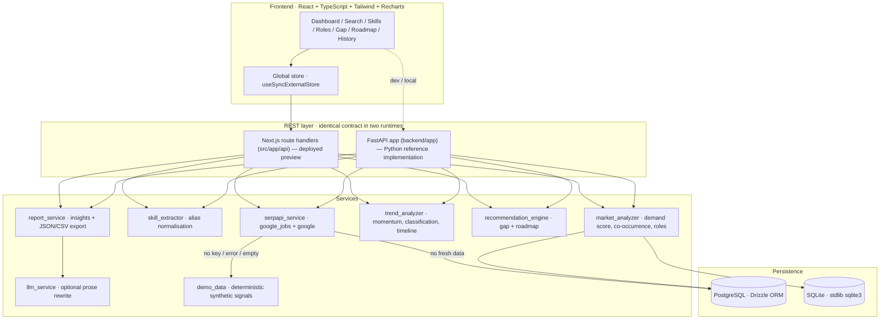

<div align="center">

# SkillPulse — Market Signal Intelligence

**Understand what the market wants before you decide what to learn.**

SkillPulse converts live job-market signals into actionable career intelligence:
skill demand scores, market momentum, co-occurrence pairs, role analytics,
skill-gap analysis and generated 30-day learning roadmaps.

`React + TypeScript + Tailwind + Recharts` · `FastAPI + Pandas + SQLite` · `SerpAPI` · `LLM (optional)`

</div>

---

## 1. Project overview

SkillPulse is a **decision-support system**, not a job board. It collects current
hiring signals for a market query (a role, a technology, an industry), extracts
and normalises the skills inside them, and turns them into measurable,
explainable intelligence that answers ten questions:

| # | Question | Where it is answered |
|---|----------|----------------------|
| 1 | What skills are in demand right now? | Dashboard → *Most demanded skills*, `/skills` |
| 2 | Which skills are growing or declining? | Momentum mix, growth-vs-demand scatter |
| 3 | Which skills appear together? | *Skill Co-occurrence* (pairs / network / heatmap) |
| 4 | What roles demand those skills? | `/roles`, skill detail → *Roles demanding it* |
| 5 | Which companies & industries hire for them? | Top employers, industries, `/api/companies` filters |
| 6 | What should a student learn now? | Insight report → *Recommendation* |
| 7 | How has demand changed over time? | *Demand over time* (observed publication dates) |
| 8 | What is the gap between market demand and my skills? | `/gap` → Market Readiness % |
| 9 | Which technologies are emerging? | *Emerging technologies*, ⚠ Emerging classification |
| 10 | Can you turn that into a plan? | `/roadmap` → week-by-week 30-day plan |

## 2. Problem statement

Students and career-switchers choose what to learn from **anecdote**: a viral
post, a relative's advice, a course ad. Meanwhile the actual market publishes
its requirements every day in job postings — but that information is scattered
across boards, phrased inconsistently ("ML", "Machine Learning", "machine
learning algorithms"), and never aggregated into something comparable.

The result is a predictable failure mode: people spend months on skills with
shrinking demand, miss emerging skills that employers are already paying a
premium for, and cannot tell how close (or far) they are from being hireable for
a specific role.

## 3. Solution

SkillPulse closes the loop in four stages:

```
COLLECT → NORMALISE → MEASURE → DECIDE
```

1. **Collect** — SerpAPI (`google_jobs` + `google` engines) returns current
   hiring results for a query. Raw results are never shown to the user.
2. **Normalise** — a curated 113-skill taxonomy with alias matching collapses
   surface variants into canonical skills; titles are attributed to 15 canonical
   roles; companies are mapped to industries.
3. **Measure** — a transparent, weighted **Skill Demand Score** (0–100), a
   **Market Momentum Score** with 5 classifications, co-occurrence **lift**, and
   role/company/industry distributions.
4. **Decide** — skill-gap readiness %, a prioritised 30-day roadmap with effort
   estimates and resources, and an insight report where every claim is tagged
   `OBSERVED DATA`, `CALCULATED METRIC` or `AI INTERPRETATION`.

**No API keys? It still works.** A deterministic seeded generator produces
realistic synthetic postings, the real extractor parses them, and every surface
is labelled **DEMO DATA**.

## 4. Key features

- **Market search** with a three-tier data strategy: `SerpAPI → cache → demo`
- **Market overview dashboard**: 8 KPIs, 7 chart types, provenance strip
- **Skill demand engine** with a published, itemised score breakdown
- **Market momentum** (🔥 Exploding · 📈 Growing · ➡️ Stable · 📉 Declining · ⚠️ Emerging)
- **Skill co-occurrence**: top pairs, interactive network, 12×12 heatmap
- **Role intelligence**: required skills, emerging skills, tools, industries,
  employers, experience bands, indicative salary, related roles (Jaccard overlap)
- **Skill gap analyzer**: weighted Market Readiness %, *You have* / *You need*,
  transferable skills, and a full explanation of the arithmetic
- **Learning roadmap**: 3–8 week plans, prerequisite-aware ordering, effort
  estimates, deliverables and real learning resources
- **Market insight generator**: LLM-assisted prose with a deterministic fallback
- **Company / industry intelligence** with role + skill + industry + location filters
- **Search history** persisted in a real database, re-openable with its full snapshot
- **Export**: full JSON report (with methodology) and CSV for 6 datasets
- **Graceful degradation everywhere**: missing key, rate limit, empty results,
  malformed response, network error, LLM unavailable, DB offline

## 5. Architecture



### Repository layout

```
skillpulse/
├── src/                         # React + TypeScript frontend & its REST layer (Next.js App Router)
│   ├── app/                     #   pages + /api route handlers
│   ├── components/              #   app shell, charts, panels, skill picker, UI kit
│   ├── hooks/                   #   global market store (useSyncExternalStore)
│   ├── lib/
│   │   ├── analytics/           #   extractor · scoring · pipeline · gap · roadmap · insights · export
│   │   ├── data/                #   serpapi service · demo dataset generator
│   │   ├── db/                  #   PostgreSQL persistence helpers
│   │   ├── services/            #   search orchestration (live → cache → demo)
│   │   ├── taxonomy.ts          #   113 skills · 15 role profiles · companies · industries
│   │   └── types.ts             #   shared domain types
│   └── db/schema.ts             #   Drizzle schema: searches, signals, skill_metrics, skill_edges, reports
├── backend/                     # Python FastAPI implementation of the same contract
│   ├── app/
│   │   ├── main.py  config.py  database.py
│   │   ├── models/  schemas/    #   domain entities · Pydantic request/response models
│   │   ├── routers/             #   market · intelligence · planning
│   │   ├── services/            #   serpapi_service, skill_extractor, market_analyzer,
│   │   │                        #   trend_analyzer, recommendation_engine, report_service,
│   │   │                        #   demo_data, llm_service, storage, search_service, taxonomy
│   │   └── utils/
│   ├── tests/                   #   49 pytest tests
│   ├── requirements.txt  .env.example
├── data/                        # SQLite file location for the FastAPI backend
├── docs/ARCHITECTURE.md         # deep dive: scoring maths, data contracts, parity notes
└── README.md
```

> **Why two runtimes?** The deployed preview runs the React frontend on Next.js
> route handlers (single deployable, PostgreSQL). `backend/` is the Python
> FastAPI reference implementation from the original brief (SQLite, Pandas) and
> exposes **the identical REST contract**, so the same UI can be pointed at it by
> changing one base URL. Scoring logic is mirrored 1:1 and both are tested.

## 6. Technology stack

| Layer | Technology |
|-------|-----------|
| Frontend | React 19, TypeScript, Tailwind CSS v4, Recharts, custom SVG (network + heatmap) |
| API (deployed) | Next.js App Router route handlers, Zod-free hand validation, `Response.json` |
| API (reference) | Python 3.11, FastAPI, Pydantic v2, Uvicorn |
| Data acquisition | SerpAPI (`google_jobs`, `google`) via `fetch` / `httpx` with timeouts |
| Analysis | Pandas (backend), hand-rolled aggregation (frontend), deterministic scoring |
| Persistence | PostgreSQL + Drizzle ORM (deployed), SQLite + stdlib `sqlite3` (backend) |
| AI | OpenAI-compatible chat completions, JSON mode — **optional**, with rule-based fallback |
| Testing | `pytest` + `TestClient` (49 tests), `tsc --noEmit`, `next build` |

## 7. How SerpAPI is used

`backend/app/services/serpapi_service.py` (and `src/lib/data/serpapi.ts`) is the
only module that talks to SerpAPI.

1. **Primary call** — `engine=google_jobs`, `q=<market query>`, `gl=in`,
   `google_domain=google.co.in`, `lru=<limit>` → `jobs_results[]`.
2. **Enrichment call** — `engine=google`, `q="<query> jobs hiring requirements <location>"`,
   `num=20` → `organic_results[]` (salary reports, hiring pages, trend articles).
3. **Normalisation** — each raw result becomes a `Signal`:
   `title, company, industry, role, location, via, url, snippet,
   publishedDaysAgo, experienceLevel, employmentType, salaryMin/Max, skills[]`.
   * `role` ← longest-match attribution against 15 canonical role profiles
   * `industry` ← known-company lookup, else keyword classifier
   * `publishedDaysAgo` ← parsed from "3 days ago" / "2 weeks ago" text; unknown → 30 (never fabricated precision)
   * `skills[]` ← alias extractor over title + description
   * results with **no recognisable skill are dropped** — they carry no market signal
4. **Failure handling** — missing key, HTTP 429, non-200, malformed JSON,
   network timeout and empty results each produce a *note* and downgrade the
   analysis to `cache` or `demo`; the API never returns a 5xx for these.

Example queries that work out of the box: `AI jobs India`,
`machine learning engineer India`, `data analyst India`, `Python developer India`,
`generative AI jobs India`, `cybersecurity jobs India`.

## 8. How market intelligence is calculated

### Skill Demand Score (0–100)

| Component | Weight | Definition |
|-----------|-------:|------------|
| Frequency | 35% | mentions ÷ mentions of the most-mentioned skill in this collection |
| Role diversity | 20% | distinct roles asking for it ÷ distinct roles observed |
| Company diversity | 10% | distinct employers ÷ min(distinct employers observed, 40) |
| Source breadth | 10% | distinct channels it appeared on ÷ distinct channels observed |
| Recency | 10% | share of its mentions from the last 14 days |
| Growth | 15% | tanh-normalised momentum of the last 30d vs prior 60d |

Every skill exposes its six point contributions in the UI and in the CSV/JSON
export — the score is auditable, never a black box.

### Market Momentum Score (0–100, 50 = flat)

```
recent_rate = mentions(last 30 days) / 30
prior_rate  = mentions(day 31–90)    / 60
growth_pct  = (recent_rate − prior_rate) / prior_rate
momentum    = clamp(50 + tanh(growth_pct / 1.2) × 45 + emerging_novelty_bonus)
```

| Classification | Rule |
|----------------|------|
| 🔥 Exploding | growth ≥ +70% **and** ≥ 3 recent mentions |
| 📈 Growing | growth ≥ +18% |
| ➡️ Stable | −18% < growth < +18% |
| 📉 Declining | growth ≤ −18% |
| ⚠️ Emerging | taxonomy-emerging skill with ≤ 2 prior-window and ≥ 2 recent mentions |

> **No fabricated history.** Growth is computed only from publication dates of
> signals collected for *this* analysis. When the sample is synthetic the UI
> says **DEMO DATA** and the report states that dates are simulated.

### Co-occurrence

```
support(A,B) = signals containing both A and B
expected     = P(A) × P(B) × N
lift         = support / expected        (kept when lift > 1.05, support ≥ 3)
```

Lift > 1 means the pair travels together more than chance — that is the
"what should I learn together" signal.

### Market Readiness (skill gap)

```
readiness = Σ weights(required skills you have) ÷ Σ weights(all required skills) × 100
```

Weights are the demand scores of the role's observed requirements (falling back
to the curated role profile, which is disclosed in the explanation).

### Roadmap priority

```
priority = (demand/100 × 0.55 + momentum/100 × 0.20 + role_weight × 0.25) ÷ (0.8 + difficulty × 0.09)
```

then a dependency pass hoists missing prerequisites ahead of the skills that
need them, and weeks are filled in priority order.

## 9. Screenshots

| Screen | What it shows |
|--------|---------------|
| Dashboard | hero, KPI row, demand bars, market pulse dials, momentum mix |
| Demand over time / Growth vs demand | observed weekly index, demand-vs-growth scatter |
| Skill co-occurrence | top pairs, interactive network, heatmap |
| Skills | ranked table + full score breakdown per skill |
| Roles | role intelligence with emerging skills, salary, related roles |
| Skill gap | readiness dial, You have / You need, score explanation |
| Roadmap | week-by-week plan, prioritisation, projected readiness |
| History | stored analyses with source labels and exports |

_Add screenshots to `docs/screenshots/` and reference them here:_

```markdown

```

## 10. Installation

### A. Deployed stack (React frontend + Next.js API + PostgreSQL)

```bash
npm install
cp .env.example .env          # optional: add SERPAPI_API_KEY / OPENAI_API_KEY
npx drizzle-kit push          # create tables
npm run dev                   # http://localhost:3000
```

### B. Python FastAPI backend (SQLite + Pandas)

```bash
cd backend
python3 -m venv .venv && source .venv/bin/activate
pip install -r requirements.txt
cp .env.example ../.env       # optional keys
uvicorn app.main:app --reload --port 8000
# interactive docs → http://localhost:8000/docs
```

## 11. Environment variables

| Variable | Required | Purpose |
|----------|:--------:|---------|
| `SERPAPI_API_KEY` (or `SERPAPI_KEY`) | no | live market signal collection; absent → demo mode |
| `OPENAI_API_KEY` (or `LLM_API_KEY`) | no | LLM prose for insight reports; absent → deterministic engine |
| `OPENAI_BASE_URL` | no | OpenAI-compatible endpoint (default `https://api.openai.com/v1`) |
| `OPENAI_MODEL` | no | default `gpt-4o-mini` |
| `DATABASE_URL` | yes (Next.js) | PostgreSQL connection string |
| `DATABASE_PATH` | no (backend) | SQLite file, default `../data/skillpulse.db` |
| `CORS_ORIGINS` | no | comma-separated origins for the FastAPI app |
| `FORCE_DEMO` | no | `true` forces demo mode even with a SerpAPI key (great for CI/demos) |
| `SERPAPI_TIMEOUT` | no | per-request timeout, default 12s |

**Secrets are read from the environment only. Nothing is hard-coded.**

## 12. Running locally

```bash
# Frontend + API (deployed stack)
npm run dev

# Python API
cd backend && uvicorn app.main:app --reload --port 8000

# Production build & start (Next.js)
npm run build && npm run start
```

Point any React client at the Python API by setting its base URL to
`http://localhost:8000` — the paths and payloads are identical.

## 13. Demo mode

Click **Try Demo** (sidebar or hero). Within ~1 second you get a complete
analysis of 120–150 synthetic postings for a GenAI/AI-Engineering market:
skills, momentum, co-occurrence, roles, employers, timeline, gap analysis and
roadmap — all fully interactive.

The demo generator is **deterministic** (seeded by query + location), so demos,
screenshots and tests are reproducible. Synthetic records are labelled
`DEMO DATA` in the header, the provenance strip, the report disclaimer and the
export document.

## 14. API documentation

Interactive: `http://localhost:8000/docs` (FastAPI) — the Next.js handlers
implement the same routes.

| Method | Path | Purpose |
|--------|------|---------|
| GET | `/health` | liveness + component health (db / serpapi / llm) |
| GET | `/api/status` | runtime capability probe used by the UI |
| POST | `/api/search` | `{query, location?, limit?, forceDemo?}` → full analysis |
| GET | `/api/search?q=` | query-string variant |
| POST | `/api/demo` | one-click labelled synthetic analysis |
| GET | `/api/market/overview?id=` | overview for one analysis or the latest |
| GET | `/api/skills?id=&q=&classification=&category=&limit=` | ranked skills + aggregates |
| GET | `/api/skills/{slug}` | demand breakdown, aliases, partners, roles |
| GET | `/api/roles?id=&role=` | role intelligence + catalogue |
| GET | `/api/companies?id=&industry=&role=&skill=&location=` | filtered employer intelligence |
| GET/POST | `/api/skill-gap` | contract / `{skills[], role, analysisId?}` → readiness |
| POST | `/api/roadmap` | `{skills[], role, weeks?, analysisId?}` → weekly plan |
| POST | `/api/market-report` | `{searchId?}` → insight report (llm or heuristic) |
| GET | `/api/history?limit=` | stored analyses |
| GET/DELETE | `/api/history/{id}` | re-open / delete one analysis |
| GET | `/api/export/{id}?format=json\|csv&dataset=…` | report export (6 CSV datasets) |

## 15. Testing

```bash
cd backend
PYTHONPATH=. python3 -m pytest tests -q
```

**Result: `49 passed` in ~0.8s.** Coverage:

| Area | Tests |
|------|-------|
| Skill normalisation | alias collapsing (`python 3` → `python`), `ML`/`GenAI`/`LLM` aliases, word-boundary false positives (`nosql` ≠ `sql`), fuzzy user input (`k8s`, `vector db`) |
| Skill extraction | multi-field extraction, evidence report, empty text |
| Demand score | frequency ranking, breakdown sums to the score, role/company diversity raises the score, bounds |
| Momentum | flat → Stable, accelerating → Exploding, shrinking → Declining, no-baseline emerging skill → Emerging |
| Co-occurrence | support + lift, chance-level pairs filtered out |
| Skill gap | weighted readiness, explanation present, 100% when fully covered |
| Roadmap | prerequisite ordering, week count, empty plan when no gap |
| API | health, status, search validation (422), demo fallback labelling, determinism, overview empty state, skills/roles/companies filters, gap/roadmap/report endpoints, history + re-open + delete, JSON/CSV export for all 6 datasets |
| Fallback | SerpAPI absent → demo, report → heuristic mode, unknown skill → graceful 404-shaped payload |

Frontend checks: `npm exec tsc -- --noEmit` and `npm run build` both pass clean.

## 16. Limitations

- SerpAPI's `google_jobs` returns a bounded result set per query (no deep
  pagination), so a single analysis is a **sample**, not a census.
- Skill extraction is dictionary-based: brand-new tools and unusual spellings are
  missed until the taxonomy is extended.
- Momentum needs a spread of publication dates; very fresh collections have a
  thin prior window and are labelled `PARTIAL`.
- Salaries are only present when the source discloses them (mostly in demo data).
- Role attribution is title-based, so ambiguous titles can land in `Other`.
- The LLM rewrites prose only; it never contributes numbers.

## 17. Future improvements

- Scheduled collectors with a true time-series store → real multi-week momentum
- LLM-assisted taxonomy expansion with human review queue
- Embedding-based skill similarity to catch paraphrases the dictionary misses
- Multi-city and multi-country comparison views; salary bands per role
- Saved profiles, alerts ("RAG demand up 40% in Bengaluru"), résumé parsing
- PDF export via headless Chromium; shareable public report links
- dbt-style test suite for score regressions on every taxonomy change

## 18. Resume-ready description

> **SkillPulse — Market Signal Intelligence** · *React, TypeScript, Next.js, FastAPI, Pandas, PostgreSQL/SQLite, SerpAPI, LLM*
> Built an AI-assisted market intelligence platform that collects live hiring signals via SerpAPI, normalises 113 skills through an alias-based extractor, and computes transparent demand (0–100) and momentum scores with 5-way trend classification, co-occurrence lift analysis, role/employer intelligence, weighted skill-gap readiness and prerequisite-aware 30-day learning roadmaps. Shipped dual runtimes (Next.js route handlers + FastAPI) over one REST contract with three-tier data fallback (live → cached → labelled demo), full JSON/CSV export, and 49 passing backend tests.

**Three-line version**

- SkillPulse turns live job-market signals (SerpAPI) into explainable skill demand and momentum scores, so learners know *what* to learn next.
- I built the collection pipeline, the scoring/co-occurrence/gap/roadmap engines, the React analytics UI and the FastAPI + Next.js REST layers.
- Everything degrades gracefully — no API key still yields a fully functional, clearly-labelled demo product.

**60-second interview pitch**

> "People pick what to learn from anecdotes, while the market publishes its
> requirements daily in job posts. SkillPulse collects those posts through
> SerpAPI, normalises the messy skill language — 'ML', 'Machine Learning',
> 'machine learning algorithms' all become one canonical skill — and measures
> demand with a transparent weighted score: frequency, role diversity, employer
> diversity, source breadth, recency and growth. Growth comes from comparing the
> last 30 days against the previous 60, so skills classify as Exploding, Growing,
> Stable, Declining or Emerging without inventing any history. On top of that I
> compute co-occurrence lift to answer 'what should I learn together', compare a
> user's skills against a role's observed requirements to produce a Market
> Readiness percentage, and turn the gap into a prioritised, prerequisite-aware
> 30-day roadmap. The LLM only rewrites the narrative — every number is measured
> and every report section is tagged observed, calculated or AI, so nobody
> mistakes a model opinion for market fact. And if no API key exists, a
> deterministic synthetic dataset keeps the whole product demonstrable."

---

### Quick start (no keys, 30 seconds)

```bash
npm install && npx drizzle-kit push && npm run dev
# open http://localhost:3000 → click "Try Demo"
```

```bash
cd backend && pip install -r requirements.txt && uvicorn app.main:app --reload
# open http://localhost:8000/docs → POST /api/demo
```
