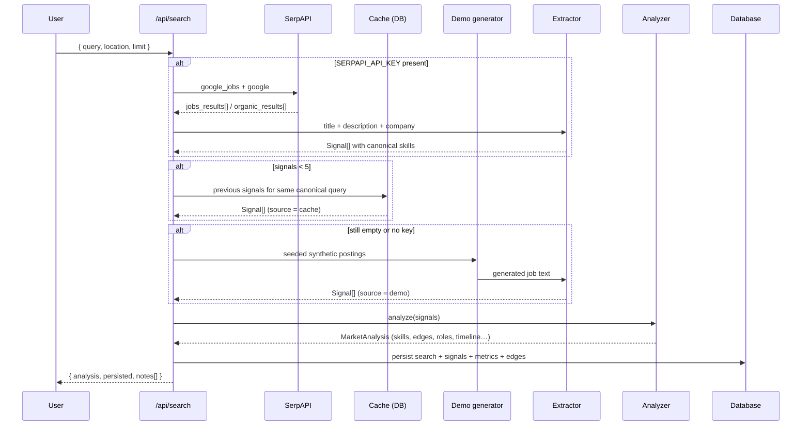

# SkillPulse — Architecture Deep Dive

## 1. Two runtimes, one contract

| Concern | Deployed stack | Python reference stack |
|---------|----------------|------------------------|
| UI | React 19 + TypeScript + Tailwind v4 + Recharts (`src/app`, `src/components`) | same UI, base URL pointed at `:8000` |
| REST | Next.js route handlers (`src/app/api/**/route.ts`) | FastAPI routers (`backend/app/routers/*`) |
| Persistence | PostgreSQL via Drizzle ORM (`src/db/schema.ts`) | SQLite via stdlib `sqlite3` (`backend/app/database.py`) |
| Aggregation | typed reducers + `Map`/`Set` | Pandas `DataFrame.groupby` |
| Validation | hand-rolled guards + `Response.json` errors | Pydantic v2 models |

Both stacks implement the identical scoring mathematics (see §4), so numbers
match for the same input sample. The TypeScript engine is the source of truth for
the deployed preview; the Python engine is exercised by 49 pytest tests.

## 2. Request lifecycle — `POST /api/search`



**Invariants**

- The response always contains a usable analysis; failures become `notes[]` +
  `status: "partial" | "failed"`, never a 5xx.
- `source` ∈ `{serpapi, cache, demo}` and `isDemo` are always set, and the UI
  renders them as `LIVE · SERPAPI`, `CACHED` or `DEMO DATA`.
- Raw SerpAPI payloads never reach the client; only normalised `Signal` records.

## 3. Data model

```
searches        1 ── * signals          (normalised market signals)
   │            1 ── * skill_metrics    (per-skill scores for this analysis)
   │            1 ── * skill_edges      (co-occurrence pairs)
   └            1 ── * reports          (generated insight reports)
```

`searches.analysis` stores the **full JSON snapshot**, so re-opening a historical
analysis is a single row read and exports never need to recompute. The normalised
child tables exist so cross-analysis SQL is possible:

```sql
-- which skills keep appearing across every analysis?
SELECT slug, name, COUNT(*) analyses, ROUND(AVG(demand_score),1) avg_demand, SUM(frequency) total
FROM skill_metrics GROUP BY slug, name ORDER BY total DESC;

-- which employers show up most across the whole corpus?
SELECT company, industry, COUNT(*) mentions, COUNT(DISTINCT role) roles
FROM signals GROUP BY company, industry ORDER BY mentions DESC;
```

## 4. Scoring mathematics

### 4.1 Skill Demand Score

```
components = {
  frequency        : mentions / max_mentions_in_collection        × 100
  roleDiversity    : distinct_roles / distinct_roles_observed      × 100
  companyDiversity : distinct_companies / min(distinct_companies, 40) × 100
  sourceBreadth    : distinct_channels / distinct_channels_observed × 100
  recency          : mentions_in_last_14d / mentions               × 100
  growth           : (50 + tanh(growth_pct/1.2) × 50)  clamped      (0–100)
}
demand = Σ components[k] × weights[k]
weights = { .35, .20, .10, .10, .10, .15 }
```

Frequency is normalised against the collection's leading skill (not against a
fixed multiplier) so the component stays discriminative instead of saturating.
Each component's point contribution is persisted and surfaced in the UI and CSV
export — the score is auditable end to end.

### 4.2 Momentum & classification

Windows: `recent = 0–30 days`, `prior = 31–90 days`.

```
recent_rate = recent / 30
prior_rate  = prior  / 60
growth_pct  = prior_rate > 0 ? (recent_rate − prior_rate)/prior_rate
                             : min(3, recent_rate × 60)     # no baseline
momentum    = clamp(50 + tanh(growth_pct/1.2) × 45 + novelty_bonus, 0, 100)
```

`novelty_bonus = 6` when a taxonomy-emerging skill has zero prior mentions.
Classification thresholds: Exploding `≥ +70% & recent ≥ 3`, Growing `≥ +18%`,
Declining `≤ −18%`, Emerging `taxonomy-emerging & prior ≤ 2 & recent ≥ 2`,
else Stable.

**Honesty rule:** the demo generator sizes its recency buckets 1:2
(28% in the recent window, 56% in the prior window) so an undrifted skill's
daily mention rate is identical in both windows and it classifies as **Stable**.
Only skills with an intentional time drift (emerging technologies up, cooling
technologies down) move. This prevents the classic "everything is exploding"
artefact of naive synthetic data.

### 4.3 Co-occurrence lift

```
support(A,B) = |{ signals containing A and B }|
lift(A,B)    = support / ( P(A) × P(B) × N )
keep when support ≥ 3 and lift > 1.05
rank by lift × ln(1 + support)
```

### 4.4 Composite market indices

```
marketScore   = 0.40·avg_demand(top10) + 0.15·avg_momentum(top10)
              + 0.20·log2(1+N)/log2(201)·100 + 0.15·freshness + 0.10·employer_diversity
momentumScore = Σ momentum_i × (0.5 + demand_i/100) / Σ (0.5 + demand_i/100)   over top 15
```

### 4.5 Gap & roadmap

```
readiness = Σ weight(required ∩ owned) / Σ weight(required) × 100
priority  = (0.55·demand + 0.20·momentum + 0.25·role_weight) / (0.8 + 0.09·difficulty)
hours     = [4, 6, 9, 13, 18][difficulty − 1]
```

Requirement set = **observed** role data when the role has ≥ 6 observed skills,
otherwise the curated taxonomy profile (basis is disclosed in the explanation).

## 5. Error-handling matrix

| Failure | Detection | Behaviour | User-visible |
|---------|-----------|-----------|--------------|
| No SerpAPI key | `getSerpApiKey()` empty | skip network, use cache → demo | `DEMO DATA` + note |
| SerpAPI 429 | HTTP status | note, `status = partial`, fall back | amber `PARTIAL` badge |
| SerpAPI non-200 | HTTP status | note, fall back | note in provenance strip |
| Malformed JSON | parse error | note, fall back | note |
| Network timeout | `AbortController` / `httpx.TimeoutException` (12s) | note, fall back | note |
| Empty results | 0 usable signals | cache → demo | "no results containing recognisable skills" |
| Low volume | < 10 signals | keep, `status = partial` | "directional only" note |
| LLM missing/failing | no key, non-200, bad JSON, timeout | deterministic report engine | `DETERMINISTIC ENGINE` badge + disclaimer |
| DB offline | connection error | analysis still returned from memory | "persistence failed" error banner |
| Bad request body | JSON/Pydantic validation | 400 / 422 with a message | inline error state |

## 6. Frontend state

A ~80-line `useSyncExternalStore` module (`src/hooks/use-market.ts`) holds the
active analysis, loading/error state and last-action message. Every page
subscribes, so running a search in the top bar updates the dashboard, skills,
roles, gap and roadmap pages without prop drilling or a state library. Skill and
role selections persist to `localStorage` between the Gap and Roadmap pages.

## 7. Provenance labelling

Three tags are rendered wherever a claim is made:

- `OBSERVED DATA` — counted directly from stored signals (frequencies, roles, employers)
- `CALCULATED METRIC` — derived by a published formula (scores, momentum, lift, readiness)
- `AI INTERPRETATION` — model-written prose (only when a key exists)

The insight report also carries a disclaimer naming the mode and model, and the
exported JSON embeds the full methodology (weights, windows, classification
rules) so a reader can reproduce every number.
